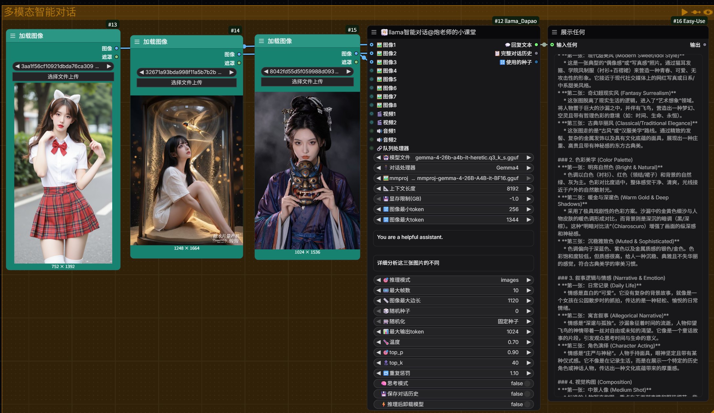
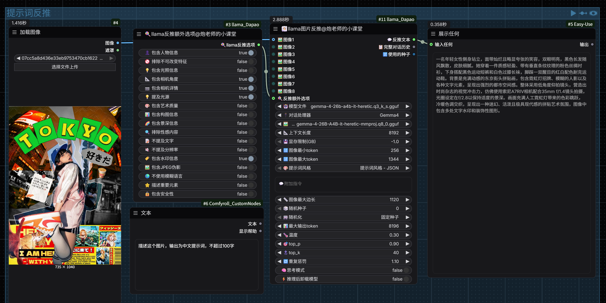
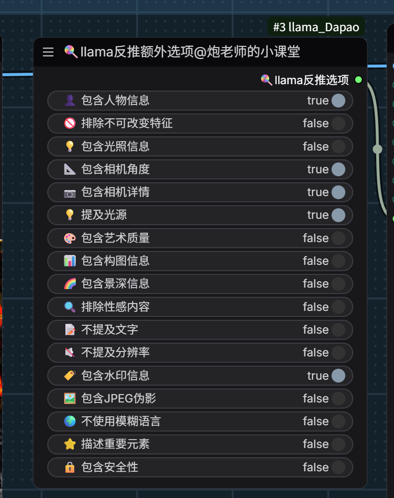
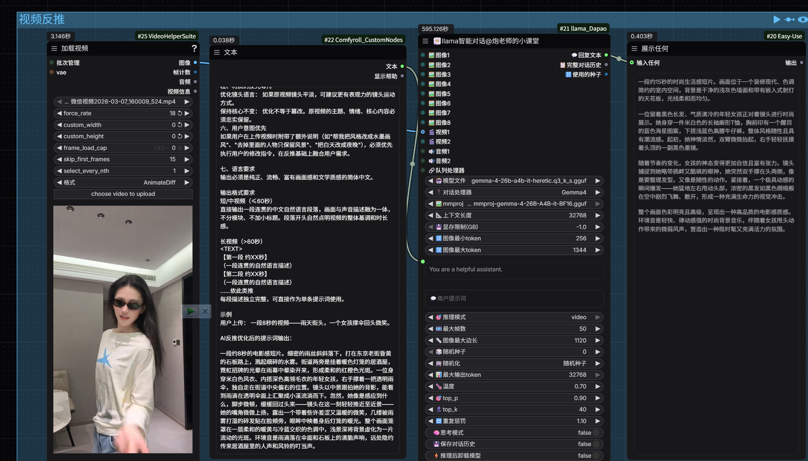

# ComfyUI-llama_Dapao

基于 llama-cpp-python 的 ComfyUI 本地大语言模型推理节点，支持多种视觉语言模型，一个节点搞定模型加载 + 参数配置 + 对话推理。

## 节点列表

### 👩 美女脸模素材

“美女脸模素材@泡老师的小课堂”：1499 张原尺寸无损脸模/造型图、发型与具体造型筛选、下载排行、六宫格快捷选择、中英文正反向提示词输出。路径跟随插件目录。详见 [美女脸模素材说明](docs/美女脸模素材.md)。

### 👗 精选服装参考

“精选服装参考@泡老师的小课堂”：六宫格快捷选择、8 类服装检索、原尺寸无损图片输出、中英文正反向提示词。个人素材单独在本机配置，不随节点代码分发。使用方法与验证范围见 [精选服装参考说明](docs/精选服装参考.md)。

### 🧍 精选姿势参考

“精选姿势参考@泡老师的小课堂”：内置 288 组、1439 张压缩姿势参考图，支持分类搜索、五种视角、多角度预览和标准 IMAGE 输出。无需模型或联网。使用方法、素材来源和验证范围见 [精选姿势参考说明](docs/精选姿势参考.md)。

### 😶‍🌫️ llama智能对话

多模态对话节点，支持文本、图像、视频、音频输入。

- 支持 8 张图像 + 2 个视频 + 2 个音频同时输入
- 多轮对话历史保持（可开关）
- 思考模式开关（Qwen/GLM/Gemma4 等支持思考的模型）
- 自动 VRAM 分配，支持手动限制显存
- 推理后可选卸载模型释放显存


### 🦊 H3本地视频提示词生成

使用本地 GGUF 多模态模型将文字、图片、视频帧和音频整理为 MiniMax H3 规范提示词。

- 独立本地推理，不调用在线 H3 节点或在线 LLM API
- 支持 T2VA、I2VA、FL2VA、L2VA 和 Ref2VA 自动识别
- 支持最多 9 张源图片、3 路视频帧批次和 3 路音频，混合素材合计最多 12 个
- 视频输入使用按时间排序的 `IMAGE` 帧批次，无需额外视频解码依赖
- 音频默认使用本地频谱、能量和静音分析；确认模型支持音频后可开启原始音频输入
- 内置字段顺序、素材编号和时间点审计，可选自动执行一次结构修复
- 推荐使用支持多图理解的 Qwen3.5、Qwen3-VL 等视觉模型及匹配的 mmproj

### 😶‍🌫️ llama图片反推

图像描述/反推提示词节点，内置多种提示词风格模板。

- 提示词风格从 `prompt/` 文件夹动态加载，支持用户自定义
- 附加指令优先：填写了附加指令则覆盖内置风格
- 支持 1-8 张图像批量反推
- 可搭配「反推额外选项」节点精细控制输出


### 🍭 llama反推额外选项

为图片反推节点提供 17 项可选增强指令，包括：

人物信息、光照描述、相机角度/参数、构图分析、景深、艺术质量评价、安全性评级等。勾选后自动附加到反推提示词中。


### 🍭 llama视频反推


### 🍬 大炮API常用工具（本地LLM版）

项目同时提供参考自 `ComfyUI-dapaoAPI` 的 7 个常用提示词工具，全部改为调用本节点选择的本地 GGUF 模型，不需要 API Key：

- 电商详情页提示词
- H3 专用提示词框与 H3 视频提示词生成
- 全能 image 提示词生成
- Music3 音乐提示词生成
- Seedance2 全能导演
- 全能视觉风格提示词

这些节点保留原工具的输入、媒体分析、结构化校验和输出口；节点中的本地模型、处理器、mmproj、上下文、显存和推理参数通过 `folder_paths` 动态读取。视觉模型请同时选择匹配的主模型和 mmproj，批量图片会在同一次本地推理中逐一传递给模型。

### 🧩 本地 Skill 多轮对话工作台

本地版已同步 API 项目的新版 Skill 与多轮会话工作流，同时保持所有推理由用户选择的 llama.cpp/GGUF 模型完成，不需要 API Key。相关节点均位于 `🍭大炮-llama-cpp`：

- `🤖大炮本地模型加载器`：选择 GGUF、mmproj、上下文和卸载策略。
- `⚙️对话增强设置`：设置系统提示词、上下文轮数、采样参数和图片 2K 上限。
- `🧩大炮Skill加载器`：选择 Skill，管理显示名，上传 ZIP/文件夹，并可用连接的本地模型优化当前或全部 Skill 名称。
- `📦大炮本地多轮对话素材库`：准备最多 20 张图片、5 个视频和 5 个音频。
- `💬大炮本地多轮对话`：完成聊天、Skill 编排、`@素材`、会话管理和最终结果输出。

推荐连接顺序：

```text
本地模型加载器 ─┬─> 多轮对话
                 └─> Skill加载器 ─> 多轮对话
对话增强设置 ────────────────> 多轮对话
多轮对话素材库 ──────────────> 多轮对话
```

素材库只是准备区。图片、视频或音频不会因为接入素材库就自动进入上下文；必须在当前聊天输入框键入 `@` 并选择 `@图片1`、`@视频1` 或 `@音频1` 后，本轮才会处理和发送。历史记录只保存素材编号与文字分析，不会在后续轮次重复注入媒体；需要模型再次查看时请重新 `@`。

图片在实际推理边界逐张用 Lanczos 等比例缩放到最长边不超过 2048px，并采用 PNG；视频均匀抽取代表帧；音频转为 16kHz 单声道 WAV。图片和视频需要匹配的 mmproj。音频是否可推理由具体 GGUF 与 llama.cpp ChatHandler 决定，不支持时节点会给出明确提示。

多轮对话节点提供三个字符串输出：`助手回复`、`会话历史JSON`、`Skill最终结果`。普通“发送”只运行聊天节点及必要上游；“清除上下文”保留可见聊天记录，但后续不再把旧记录交给模型；“发送最终状态”不调用本地模型，只把 Skill 最终结果（没有时使用最近助手回复）送到真实下游。界面还支持安全 Markdown、代码复制、导入/导出、历史编辑重发、从此删除、60 秒撤销和自由调整节点高度。

Skill 文件放在插件内的 `skills/`。支持标准的 `skills/<skill-id>/SKILL.md`，也支持仓库包的 `skills/<repo>/skills/<skill-id>/SKILL.md`。上传会检查路径穿越、符号链接、重复路径、文件数和解压大小；同名目录不会自动覆盖。显示别名单独保存在 `data/skill_display_names.json`，手动名优先级高于本地模型生成名，任何改名都不会修改 Skill 正文、ID、触发条件或功能。

## 支持的模型/处理器

| 处理器 | 说明 |
|--------|------|
| None | 纯文本模型，无需 mmproj |
| LLaVA-1.5 / 1.6 | LLaVA 系列视觉模型 |
| Moondream2 | 轻量视觉模型 |
| MiniCPM-v2.6 / v4.5 | MiniCPM 视觉模型 |
| Gemma3 / Gemma4 | Google Gemma 视觉模型 |
| Qwen3.8 | Qwen3.8-VL 多模态模型，需要匹配的 mmproj |
| Qwen2.5-VL / Qwen3-VL | Qwen 视觉模型 |
| Qwen3.5 | Qwen3.5 多模态模型 |
| GLM-4.6V / GLM-4.1V | 智谱 GLM 视觉模型 |
| LFM2-VL | Liquid 视觉模型 |
| Granite-Docling | 文档理解模型 |

Qwen3.8 官方定位为统一视觉语言模型，GGUF 架构标识为 `qwen35`。主模型和对应 mmproj 都放入 `ComfyUI/models/LLM/`；节点选择 `Qwen3.8` 后可直接进行图像、视频帧和文本推理。推理强度已中文化为“关闭、自动、低、中等、高”，默认关闭；其中“自动/高”对应模型原生的 `xhigh`。

带 `-Thinking` 后缀的处理器默认开启思考模式。

## 安装

### 1. 安装依赖

ComfyUI Manager 会读取项目根目录的 `requirements.txt`。依赖使用标准的 Git 源声明，不包含整合包或便携 Python 的固定路径。

Qwen3.8 至少需要 JamePeng `llama-cpp-python 0.3.47+`。旧版 `0.3.35` 无法加载带 MTP/NextN 层的 Qwen3.8 GGUF，典型底层错误为：

```text
missing tensor 'blk.64.ssm_conv1d.weight'
```

CPU 用户可直接通过 `requirements.txt` 从源码安装。NVIDIA GPU 用户可先完成节点依赖安装，再从 [JamePeng/llama-cpp-python Releases](https://github.com/JamePeng/llama-cpp-python/releases) 下载与操作系统、Python 版本和 CUDA 版本完全匹配的 `0.3.47+` wheel 覆盖源码构建结果。

便携 Python 的通用安装方式如下，`python.exe` 应替换为当前 ComfyUI 实际使用的 Python，可在节点报错末尾看到该路径：

```bash
python.exe -m pip install -r requirements.txt
# NVIDIA GPU：安装完 requirements 后，用匹配的 GPU wheel 覆盖源码构建结果
python.exe -m pip install --upgrade --force-reinstall <下载的wheel文件.whl>
```

安装完成后必须重启 ComfyUI。不要只按显卡驱动显示的最高 CUDA 版本选择 wheel，还要确认 wheel 自带的 CUDA 运行库与当前环境兼容。

### 2. 模型文件

将 GGUF 模型文件放到 `ComfyUI/models/LLM/` 目录下，节点会自动扫描。

视觉模型需要同时放入对应的 mmproj 文件（文件名包含 `mmproj`）。

## 自定义反推提示词

插件目录下的 `prompt/` 文件夹存放反推提示词模板：

```
ComfyUI-llama_Dapao/
  prompt/
    提示词风格 - 标签.txt
    提示词风格 - 简单.txt
    提示词风格 - 详细.txt
    ...
```

原节点引自：https://github.com/lihaoyun6/ComfyUI-llama-cpp_vlm
